  <h1>🏰 King Bug Castle (KBC)</h1>
  
<strong>Private Server &amp; Bộ công cụ Reverse Engineering đầy đủ cho "King God Castle" (v170.1.00 – v174.1.00)</strong>

  
  
  
  
  

  🇬🇧 <a href="README.md">Read in English</a>

 

> **⚠️ MIỄN TRỪ TRÁCH NHIỆM:** Đây là dự án do người hâm mộ làm, phi lợi nhuận, **chỉ nhằm mục đích học tập, nghiên cứu và tương tác giữa các hệ thống**. Dự án không liên kết, không được bảo trợ và không có quan hệ với Awesomepiece. Toàn bộ logic game phía server được mô phỏng cục bộ. Client chỉ được patch để bỏ qua certificate pinning và các kiểm tra anti-cheat cục bộ (XIGNCODE3 / NEO), phục vụ phát triển offline và bắt lưu lượng nội bộ.

---

## 💬 Cộng đồng & Discord

Tham gia Discord để nhận thông báo server, thảo luận reverse engineering, báo lỗi, chia sẻ bản build và nhờ hỗ trợ:

  
   
  👉 <strong><a href="https://discord.gg/6tDBPs9chp">https://discord.gg/6tDBPs9chp</a></strong>

---

## 📖 Tổng quan

**King Bug Castle** là một dự án reverse-engineering nhằm dựng lại toàn bộ backend API cho game mobile *King God Castle* (`com.awesomepiece.castle`).

Bằng cách dump metadata IL2CPP và nghiên cứu lưu lượng mạng, dự án đã ánh xạ và trả lời **toàn bộ hơn 350 endpoint REST** mà client có thể gọi, hơn 400 wire model, và dựng lại một server FastAPI mô phỏng đầy đủ hạ tầng của game. Nhờ đó có thể chơi hoàn toàn offline, sửa dữ liệu (Vàng, Kim cương, Cấp), thử trang bị tuỳ biến, nghiên cứu cơ chế chuyên sâu, và chơi nhiều người riêng mà không chạm vào server production.

## ✨ Tính năng chính

* 🚀 **Mô phỏng API đầy đủ**: Server Python/FastAPI tái tạo chính xác hành vi của `axis-game.awesomepiece.com` và `kgc-k8s-1.awesomepiece.com`.
* 🛡️ **Pipeline thích ứng client (ARM64)**: Pipeline Python tự động (`rebuild_arm64.py` cho v170, `build_private.py` cho v171+) chuẩn bị client cho môi trường local/offline, bao gồm việc chấp nhận chứng chỉ tự ký khi phát triển cục bộ.
* 📦 **Bộ bung XIGNCODE NEO**: Các bản hiện đại (v171+) không có `libil2cpp.so` trên đĩa — mã game được mã hoá bên trong thư viện anti-cheat. `server/patchers/unpack_neo.py` phục hồi một ELF có thể liên kết được hoàn toàn offline (RSA-1024 → ChaCha20 → LZ4), cho phép inject chính mã game của bản build đó.
* 👻 **Lớp tương thích anti-cheat**: Mô phỏng trao đổi seed của Wellbia (`/auth/xcdSeed`) và cung cấp một stub native thoả mãn các kiểm tra lúc khởi động để game chạy offline hoàn toàn.
* ⚔️ **Đầy đủ gameplay & hệ thống con**: Cài đặt trọn vẹn cơ chế gồm Rift Weapon & Crystal, hệ thống Trang sức (nâng cấp, phân rã, đổi dòng, preset), Clan Raid, vòng lặp trận đấu, Đấu trường, Bảng xếp hạng, Pass & Journey, và Story Mode.
* 🛠️ **Bộ công cụ `kgc-cli`**: Tiện ích dòng lệnh dùng để trích xuất asset cực nhanh, mirror CDN S3 và diff dữ liệu XML.
* 🗃️ **State hot-reload & Dashboard quản trị web**: Trạng thái người chơi nằm trong SQLite (`server/state/players.db`, qua `playerdb.py`), kèm dashboard Vue 3 (`/admin`) để sửa tài nguyên tức thì, gửi thư và quản lý server.

---

## 🛠️ Môi trường & Yêu cầu

Để chạy backend và các script deploy, hệ thống cần:

* **Hệ điều hành**: **Linux, macOS hoặc Windows.** Server và pipeline build thuần Python + vài công cụ Java/adb. (redroid chỉ chạy trên Linux, nhưng BlueStacks / LDPlayer / máy thật chạy được trên mọi OS.)
* **Python**: 3.9 trở lên.
* **Công cụ hệ thống** (có trên `PATH`): `apktool`, `apksigner`, `zipalign`, `adb`, và một JRE. `python3 setup.py` sẽ kiểm tra và in gợi ý cài theo từng OS. **Không cần Android NDK/SDK** — các thành phần `.so` native được ship sẵn bản build.
* **Thiết bị**: **redroid** (Linux/Docker, chạy với `androidboot.redroid_gpu_mode=guest`), **BlueStacks**, **LDPlayer**, hoặc **điện thoại Android thật** (bật USB debugging).
* **Cài một lần**: `python3 setup.py` rồi `pip install -r server/requirements.txt`. Xem **[SETUP.md](SETUP.md)**.

---

## 🗺️ Kiến trúc & Luồng hoạt động

Server mô phỏng được thiết kế để chặn và xử lý toàn bộ lưu lượng từ client bằng cách tái tạo đầy đủ kiến trúc backend của King God Castle.

### Thành phần hệ thống

1. **Backend FastAPI (`server.py` + các module route theo miền)**: đóng vai server game trung tâm (`axis-game.awesomepiece.com`), trả lời mọi endpoint client gọi. *Luật* phản hồi là dữ liệu, không phải code — JSON phẳng trong `server/data/` — còn tiến trình người chơi lưu trong SQLite (`server/state/players.db`, chế độ WAL, mỗi tài khoản một dòng, quản lý qua `playerdb.py`).
2. **Bộ patch nhị phân (`rebuild_arm64.py` cho v170, `build_private.py` cho v171+)**: chuẩn bị client cho local/offline — xử lý chứng chỉ trở nên dễ dãi với chứng chỉ tự ký cục bộ, và bỏ qua các điểm gây NRE đã biết trong UI.
3. **CDN XML cục bộ**: game tải "Patch Assets" (bảng XML) lúc khởi động. Dự án mirror CDN S3 chính thức về cục bộ và backend trỏ game vào CDN của mình (`kgc-cdn-1.awesomepiece.com`), cho phép thêm vật phẩm, sửa text và đổi luật chơi qua `rebuild_xml_bundle.py`.
4. **Stub XIGNCODE3 + host hook native (`jni/stub.cpp`)**: module anti-cheat độc quyền chặn game khởi động nếu không tới được server Wellbia. Dự án thay `libxigncode.so` bằng thư viện native của mình: đăng ký các phương thức JNI `ZCWAVE_*` rỗng, giả lập bắt tay `/auth/xcdSeed`, và cài các hook il2cpp cho tính năng trong game.

```mermaid
graph TD
    Client[📱 Client Android / Emulator]
    FastAPI[⚡ Server FastAPI cục bộ / công khai]
    CDN[📦 CDN XML cục bộ]
    XIGNCODE[🛡️ Stub Xigncode + hook il2cpp]
    Data[(Luật JSON + save SQLite)]

    Client -- "HTTPS (TLS đã bypass qua patch ARM64)" --> FastAPI
    Client -- "Tải bundle XML patch" --> CDN
    FastAPI <--> Data
    Client <-->|"Bắt tay seed giả lập"| XIGNCODE

    style Client fill:#2D3748,stroke:#4A5568
    style FastAPI fill:#009688,stroke:#00796B
    style Data fill:#D69E2E,stroke:#B7791F
    style CDN fill:#3182CE,stroke:#2B6CB0
```

---

## 🧭 Trung tâm tài liệu

Toàn bộ quá trình teardown và dựng lại đều đã được ghi chép. Chọn hướng phù hợp với bạn:

### 🎓 Tiếp quản / bảo trì dự án
Mới nhận repo, hoặc quay lại sau một thời gian?
👉 **Đọc [HANDOVER.md](HANDOVER.md)** — checklist ngày đầu, công việc định kỳ, và sổ tay các bẫy.

### 🚀 Tự chạy server (bắt đầu ở đây)
Đã clone repo và muốn có server chạy được + client cho redroid / BlueStacks / LDPlayer / máy thật?
👉 **Đọc [SETUP.md](SETUP.md)** — một script, mọi OS, mọi thiết bị.

### 🛠️ Vận hành & sửa server (cấp vật phẩm, mở khoá nội dung, tạo stage test)
Server đã chạy và bạn muốn cấp tiền tệ/skin/treasure, mở khoá nội dung, hoặc tạo stage toàn dummy?
👉 **Đọc [Cơ sở tri thức vận hành](docs/README.vi.md)** — các playbook thực dụng.

### 👨‍💻 Cho lập trình viên backend & người đóng góp
Muốn đi sâu vào nội bộ server, pipeline patch và các phản hồi API?
👉 **Đọc [Hướng dẫn server & quy trình](server/README.md)**

### 🎮 Cho người dùng cuối / người chơi
Bạn vừa tải bản `.zip` release và muốn biết cách cài lên thiết bị/emulator?
👉 **Đọc [Hướng dẫn cài đặt cho người chơi](README_PLAYER.md)**

### 🧠 Cho người làm reverse engineering
Muốn hiểu cách dump IL2CPP, ánh xạ route, phá SSL pinning và trích xuất binary đóng gói NEO?
👉 **Đọc [Cơ sở tri thức & ghi chú teardown](KNOWLEDGE.md)** và **[Hướng dẫn trích xuất NEO](docs/mftl-extraction.md)**.

### 📓 Nhật ký dự án
Toàn bộ hành trình — dòng thời gian, sổ tay các bẫy, và bản kể chuyện song ngữ:
👉 **[Blog](docs/blog/vi.html)** · **[Dòng thời gian](docs/history/timeline.vi.md)** · **[Nhật ký phiên](docs/history/sessions.md)**

---

## 📂 Bố cục repository

| Thư mục | Mục đích |
| --- | --- |
| 📁 `docs/` | Cơ sở tri thức vận hành — playbook cấp vật phẩm, mở khoá nội dung, sửa stage/master data ([`docs/README.vi.md`](docs/README.vi.md)). |
| 📁 `server/` | Backend FastAPI, các module route, và script build client (`rebuild_arm64.py`, `build_private.py`). |
| 📁 `server/routes/` | Handler route theo miền (`rift.py`, `accessory.py`, `shop.py`, `pvp.py`, `clan.py`, v.v.). |
| 📁 `server/data/` | Model JSON tĩnh và template phản hồi (Docs: [`server/data/README.md`](server/data/README.md)). |
| 📁 `server/patchers/` | Các patcher APK/nhị phân mà script build gọi — rebind host, đổi tên gói, sửa metadata, và `unpack_neo.py`. |
| 📁 `server/xml_live/` | Master data được sửa trực tiếp. Sửa ở đây, rồi `rebuild_xml_bundle.py` để đẩy lên client. |
| 📁 `server/webui/` | Dashboard quản trị (Vue 3, vendored — không cần bước build). |
| 📁 `api/` | Tích hợp phụ trợ và endpoint cho công cụ ngoài. |
| 📁 `scripts/` | Script shell và Python tự động hoá việc tải CDN và trích xuất asset. |
| 📁 `xml_history/` | Ảnh chụp nguyên bản master data CDN theo từng patch (để tham chiếu; server không đọc từ đây). |
| 📁 `il2cpp/` & `ghidra/` | Metadata đã dump (`dump.cs`), string literal, và project Ghidra. |
| ⚙️ `kgc-cli` | Công cụ nhị phân chính cho các thao tác dữ liệu. |

---

## 🤝 Đóng góp

Dự án phụ thuộc vào việc ánh xạ liên tục khi game cập nhật. Nếu bạn gặp một route chưa map trả `500` hoặc object rỗng, hãy bắt lưu lượng thật bằng `mitmproxy`, tìm model tương ứng trong `server/generated/models.json`, rồi thêm override trong `server.py` hoặc module route theo miền.

---

## 💖 Ủng hộ

Nếu dự án giúp ích cho việc nghiên cứu, học reverse-engineering, hoặc đơn giản là bạn thấy vui khi nghịch private server này, hãy cân nhắc ủng hộ. Duy trì dự án đòi hỏi phải teardown liên tục mỗi khi game cập nhật.

